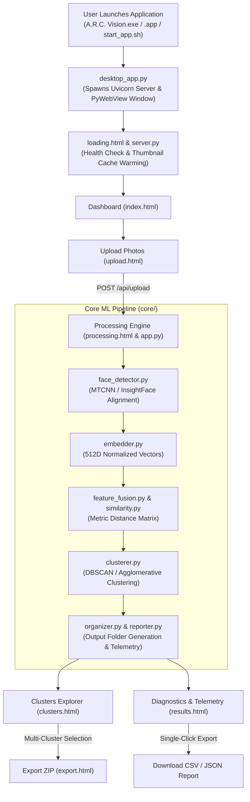

# A.R.C. Vision — Complete Project Architecture & Structure Documentation
---

## 1. Top-Level Repository Overview

The repository is divided into two primary workspaces:
- **`app/`**: Standalone packaged binaries and 1-click launchers for production client deployment on Windows and macOS.
- **`Source Code/`**: Complete uncompiled source tree containing the FastAPI Python backend and the vanilla HTML5/CSS3/JavaScript frontend.

```
A.R.C Vision/
├── app/                                 # Packaged production executables and OS-specific 1-click launchers.
│   ├── A.R.C. Vision.bat                # Windows interactive batch script with diagnostic console output.
│   ├── A.R.C. Vision.app/               # macOS native application bundle containing metadata and Mach-O binaries.
│   │   └── Contents/                    # Standard macOS application bundle contents directory.
│   │       ├── Info.plist               # Bundle property list specifying executable name, identifier, and version.
│   │       ├── PkgInfo                  # Legacy package type identifier file for macOS bundle validation.
│   │       ├── MacOS/                   # Directory containing compiled binary executables for macOS.
│   │       │   ├── applet               # AppleScript execution runner binary.
│   │       │   └── ARC_Vision           # Native compiled Mach-O launcher binary bootstrapping backend and webview.
│   │       ├── Resources/               # Application resource bundle containing icons, scripts, and asset catalogs.
│   │       │   ├── applet.icns          # Multi-resolution macOS application icon bundle.
│   │       │   ├── applet.rsrc          # Resource fork archive supporting AppleScript applet execution.
│   │       │   ├── Assets.car           # Compiled macOS asset catalog for native UI rendering.
│   │       │   └── Scripts/             # AppleScript automation scripts folder.
│   │       │       └── main.scpt        # AppleScript automating environment resolution and background process startup.
│   │       └── _CodeSignature/          # Apple code signing directory ensuring bundle integrity.
│   │           └── CodeResources        # XML plist recording cryptographic resource hashes for Gatekeeper validation.
│   └── PROJECT_STRUCTURE.md             # This comprehensive architecture and file structure documentation file.
│
├── README.md                            # Primary project documentation detailing features, setup, and execution.
│
└── Source Code/                         # Root directory containing all uncompiled source code and build assets.
    ├── start_app.sh                     # Cross-platform Unix/macOS launcher bootstrapping backend and opening desktop UI.
    │
    ├── Back End/                        # Python backend services, ML clustering engines, and REST API server.
    │   ├── app.py                       # Standalone pipeline orchestrator executing face detection, clustering, and reporting.
    │   ├── check_env.py                 # Environment validation tool verifying PyTorch, CUDA/MPS, and package dependencies.
    │   ├── config.py                    # Central configuration defining paths, model parameters, ports, and constants.
    │   ├── desktop_app.py               # PyWebView/Edge desktop wrapper providing native file dialogs and window management.
    │   ├── launcher_mac.c               # Native C source code for compiling the macOS desktop launcher binary.
    │   ├── launcher_win.c               # Native C source code for compiling the Windows desktop launcher executable.
    │   ├── launcher_win.py              # Windows Python launcher managing embedded environment startup.
    │   ├── launch_win.ps1               # Windows PowerShell execution script with automated dependency checks.
    │   ├── requirements.txt             # Python dependency manifest specifying exact package versions.
    │   ├── run.bat                      # Windows batch runner to launch the backend in terminal mode.
    │   ├── run_confidence_test.bat      # Windows batch utility to run automated clustering confidence benchmarks.
    │   ├── server.py                    # FastAPI REST server providing WebSocket telemetry, clustering APIs, and export jobs.
    │   ├── setup.bat                    # Windows installation script that configures virtual environments and wheels.
    │   ├── start_server.sh              # Unix shell script starting the Uvicorn server directly on port 8000.
    │   ├── input/                       # Storage directory where incoming raw photo batches are uploaded for processing.
    │   ├── output/                      # Storage directory where clustered person folders (Person001/, etc.), Unknown/, Flagged/, NoFace/, thumbnails, and JSON audits are saved.
    │   │
    │   ├── core/                        # Core algorithmic engine implementing facial recognition and clustering.
    │   │   ├── __init__.py              # Python package marker exposing core machine learning pipeline modules.
    │   │   ├── clusterer.py             # Unsupervised face clustering module implementing DBSCAN and agglomerative grouping.
    │   │   ├── embedder.py              # Deep feature extraction module generating 512D normalized facial embeddings.
    │   │   ├── face_detector.py         # Face detection and landmark alignment module based on MTCNN and InsightFace.
    │   │   ├── feature_extractor.py     # Multi-modal feature extractor for contextual visual and color descriptors.
    │   │   ├── feature_fusion.py        # Vector fusion module combining facial embeddings with contextual feature vectors.
    │   │   ├── organizer.py             # File system organizer creating person folders and moving/linking clustered images.
    │   │   ├── reporter.py              # Telemetry engine computing ARI/NMI clustering accuracy, F1-scores, and metrics.
    │   │   └── similarity.py            # Mathematical similarity engine computing cosine distance and confidence scores.
    │   │
    │   ├── utils/                       # Shared utility libraries supporting data transformation and logging.
    │   │   ├── __init__.py              # Python package marker exposing utility functions across the backend.
    │   │   ├── image_utils.py           # Image decoding, EXIF orientation correction, and thumbnail generation utilities.
    │   │   └── logging_utils.py         # Formatted console logging and persistent file auditing subsystem.
    │   │
    │   └── tests/                       # Automated test suites validating correctness, APIs, and scale performance.
    │       ├── __init__.py              # Python package marker for unittest test discovery.
    │       ├── confidence_test.py       # Benchmark script evaluating clustering accuracy against reference datasets.
    │       ├── test_api_endpoints.py    # Integration tests verifying REST endpoints, health checks, and single-file CSV export.
    │       ├── test_cosine_similarity.py# Unit tests verifying mathematical cosine similarity and threshold decisions.
    │       ├── test_deletion_verification.py # Unit tests asserting non-destructive cluster and photo deletion behaviors.
    │       ├── test_manual_photo_management.py # Unit tests validating photo reassignment and cluster merging.
    │       ├── test_merge_cluster.py    # Unit tests for cluster unioning, metadata merging, and cover photo updating.
    │       ├── test_merge_duplicates.py # Unit tests ensuring duplicate photos are detected and handled without data loss.
    │       ├── test_performance_scale.py# Benchmark suite stress-testing 3,000 photos across 5 events for latency SLA.
    │       └── test_torso_artifact_filtering.py # Unit test suite validating false-positive torso emblem filtering and Must-Not-Link intra-photo collision purging.
    │
    └── Front End/                       # Responsive web client interface built with HTML5, CSS3, and JavaScript.
        ├── clusters.html                # 3-Tier hierarchical clustering viewer (Events -> Face Clusters -> Photos).
        ├── export.html                  # Live progress monitor for high-speed background ZIP packaging and download.
        ├── index.html                   # Central executive dashboard displaying system telemetry, recent events, and metrics.
        ├── loading.html                 # Animated splash screen shown during application launch and server warming.
        ├── photo_library.html           # Comprehensive photo catalog with multi-event filters, lightbox, and search.
        ├── processing.html              # Real-time clustering pipeline monitor showing live progress bars and terminal logs.
        ├── results.html                 # Diagnostics view displaying clustering metrics, ARI/NMI scores, and CSV/JSON export.
        ├── upload.html                  # Drag-and-drop photo upload portal with event folder creation and batch selection.
        │
        ├── css/                         # Application styling and design token definitions.
        │   └── styles.css               # Unified stylesheet defining dark theme, glassmorphism, responsive grids, and animations.
        │
        ├── scripts/                     # Client-side JavaScript application logic.
        │   └── script.js                # Core controller handling REST APIs, WebSocket feeds, DOM rendering, and modals.
        │
        └── media/                       # Static media, icons, and multimedia branding assets.
            ├── favicon.ico              # Browser tab icon for application branding.
            ├── Footer.png               # High-resolution footer logo asset.
            ├── Intro Logo.mp4           # Video animation displayed during splash screen startup.
            └── Logo.png                 # Primary A.R.C. Vision branding graphic.
```

---

## 2. Subsystem & Component Group Explanations

### 2.1. Standalone Application Launchers (`app/`)
* **Section Explanation**:
  The `app/` directory encapsulates the production-ready distribution packages for Windows and macOS. It provides platform-native entry points including Windows executables (`.exe`), batch scripts (`.bat`), silent VBScript wrappers (`.vbs`), and a standard macOS Application bundle (`.app`). These launchers automatically resolve the local Python runtime, start the background FastAPI service if not already active, and display the user interface in a dedicated desktop window without requiring terminal commands.

### 2.2. Machine Learning Core Pipeline (`Source Code/Back End/core/`)
* **Section Explanation**:
  The `core/` package forms the machine learning backbone of A.R.C. Vision. It orchestrates the automated recognition pipeline: detecting and aligning faces while filtering torso/emblem false positives (`face_detector.py`), extracting deep 512D identity embeddings (`embedder.py`), calculating pairwise metric distances (`similarity.py`), fusing contextual features (`feature_fusion.py`), and partitioning identities using density-based DBSCAN clustering with intra-photo collision purging (`clusterer.py`). After grouping, `organizer.py` physicalizes the clusters into categorized filesystem directories (`Person001/`, `Unknown/`, `Flagged/`) using unified deterministic sorting while `reporter.py` computes mathematical clustering quality metrics (ARI, NMI, precision, and recall).

### 2.3. FastAPI Server & REST Subsystem (`Source Code/Back End/`)
* **Section Explanation**:
  The backend server layer (`server.py`, `config.py`, `desktop_app.py`) provides the bridge between the machine learning pipeline and the frontend user interface. `server.py` hosts a high-performance asynchronous FastAPI server providing REST endpoints for cluster management (renaming, merging, deletion), event-scoped single-pass storage indexing (`output_cluster_map`), thumbnail generation with draft JPEG decoding and immutable browser caching, real-time WebSocket progress streaming, and background ZIP packaging. `desktop_app.py` embeds the server lifecycle into a native PyWebView or Chrome/Edge App-Mode desktop window with bi-directional native file picker dialogs.

### 2.4. Utilities & Scale Benchmarks (`Source Code/Back End/utils/` & `tests/`)
* **Section Explanation**:
  The `utils/` and `tests/` directories provide foundational data utilities and comprehensive automated test coverage. `image_utils.py` handles fast EXIF transposition, draft-mode JPEG downscaling, and thumbnail caching, while `logging_utils.py` delivers structured audit logs. The test suite contains 40 unit and integration tests verifying mathematical cosine distance calculations, non-destructive deletion, cluster merging, single-file CSV diagnostics downloads, torso artifact filtering, and stress-testing datasets of up to 3,000 photos across 5 events (25 GB scale) with sub-millisecond warm lookups.

### 2.5. Frontend User Interface & Controller (`Source Code/Front End/`)
* **Section Explanation**:
  The frontend is an interactive, modern web application structured across 8 dedicated HTML views, a centralized glassmorphic stylesheet (`styles.css`), and an asynchronous controller (`script.js`). It implements a 3-tier browsing hierarchy (Tier 1 Events -> Tier 2 Face Clusters -> Tier 3 Photo Gallery) with dual-layer pagination for 200+ clusters via `IntersectionObserver` sentinels (`#tier2Sentinel`, `#tier3Sentinel`), dynamic telemetry (`Showing X of Y face clusters`), "Load More" and "Show All" buttons, modal dialogs for cluster merging/reassignment, live WebSocket pipeline telemetry, and single-click CSV/JSON diagnostic reporting.

---

## 3. End-to-End Workflow & Component Relationships



---

*Documentation verified and synchronized against repository source code.*
